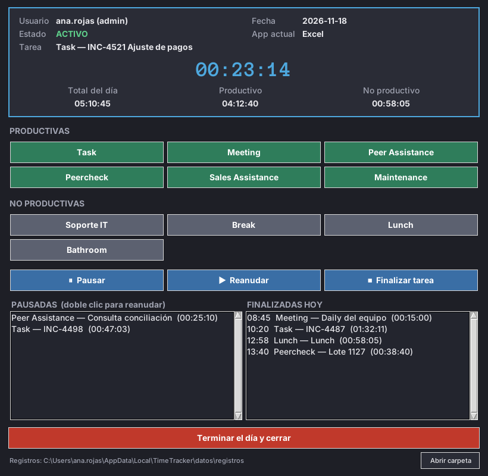
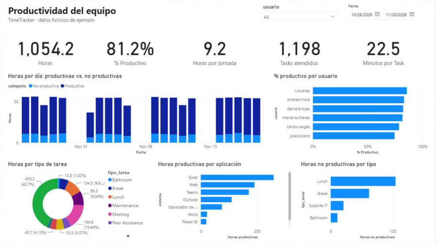
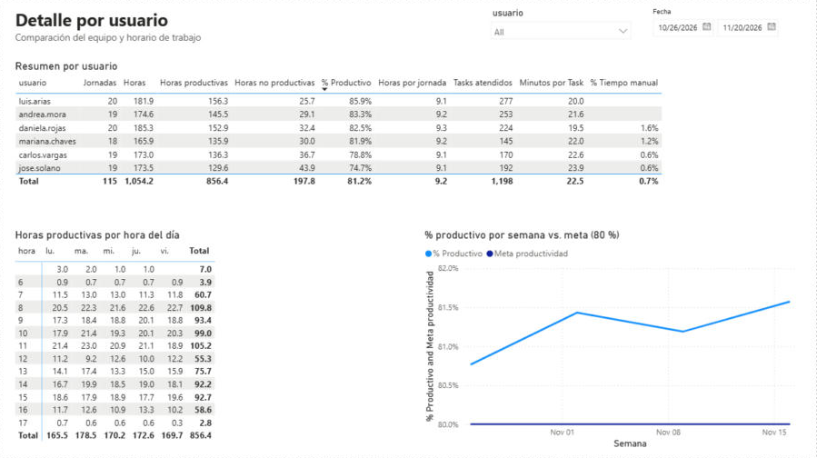

# TimeTracker ⏱️

Aplicación de escritorio para **registrar el tiempo por tarea** durante la jornada. Detecta automáticamente qué programa estás usando y genera registros en CSV listos para analizar en **Power BI**.



## Qué hace

- **Registro por tarea**: botones para tareas productivas (Task, Meeting, Peer Assistance…) y no productivas (Break, Lunch…), configurables.
- **Detección de la aplicación activa** (Excel, Outlook, Web, Explorador…): el tiempo se reparte según el programa que realmente usaste.
- **Pausar y reanudar** tareas sin duplicar tiempo; lista de pausadas y finalizadas.
- **No pierde datos**: cada tramo se guarda al instante; si la app se cierra de golpe, al abrirla recupera la sesión.
- **Maneja casos reales**: corta los registros a medianoche y no cuenta el tiempo con la PC suspendida.
- **Usuarios y roles** (ADMIN / USUARIO) con contraseñas cifradas; el admin puede crear usuarios y agregar tiempo manual.
- **Tema oscuro y claro.**
- **Sin dependencias externas**: solo la librería estándar de Python.
- **Dashboard de Power BI incluido**, con datos ficticios para probarlo sin instalar nada más.

## Dashboard de Power BI





**Página "Resumen"**: horas totales, % productivo, horas por jornada, Tasks atendidos y minutos por Task. También muestra las horas por día (productivas y no productivas), el ranking de productividad por usuario, la distribución por tipo de tarea y las horas por aplicación.

**Página "Detalle por usuario"**: una tabla comparativa del equipo, un mapa de calor de las horas productivas por hora y día de la semana, y la tendencia semanal comparada con la meta del 80 %.

Los datos de [`datos_ejemplo/registros_ejemplo.csv`](datos_ejemplo/registros_ejemplo.csv) son **ficticios**: 6 usuarios inventados, 4 semanas y unos 6,000 registros con las mismas columnas que genera la app. Se pueden regenerar con `python datos_ejemplo/generar_datos.py`.

### Abrir el dashboard

1. Abre `dashboard/TimeTracker.pbip` con **Power BI Desktop**.
2. Ve a **Transformar datos → Editar parámetros** y cambia `CarpetaRegistros` por la ruta de tu carpeta `datos_ejemplo` (o la carpeta `registros` real de la app).
3. Haz clic en **Actualizar**.

El proyecto está en formato **PBIP** (texto), así que en GitHub se puede ver cada cambio del modelo y de los visuales.

## Requisitos

- **Windows 10/11** para la detección de la app activa (usa la API de Windows vía `ctypes`).
  En otros sistemas funciona, pero registra la app como "Desconocido".
- **Python 3.10+** (solo si lo ejecutas desde el código; el `.exe` no lo necesita).

## Uso

### Opción A: ejecutable (.exe)

```bat
build.bat
```

Genera `dist\TimeTracker.exe`. Ese único archivo se puede copiar a cualquier PC con Windows.

### Opción B: desde el código

```bash
python app.py
```

La primera vez pide crear la **cuenta de administrador**. Desde **Admin → Panel de administración** se crean los demás usuarios.

## Dónde se guardan los datos

| Qué | Dónde |
|---|---|
| Configuración, estado de la sesión, log | `%LOCALAPPDATA%\TimeTracker\` |
| Usuarios y registros CSV | `%LOCALAPPDATA%\TimeTracker\datos\` (o la carpeta que indiques en `carpeta_datos`) |

Para centralizar los datos de un equipo, pon en `carpeta_datos` una carpeta compartida (por ejemplo, una de OneDrive o SharePoint sincronizada). Cada usuario escribe **su propio archivo por día** (`registros_<usuario>_<fecha>.csv`), así que no hay conflictos entre equipos.

## Configuración

`config.json` se crea solo la primera vez. Ver [`config.example.json`](config.example.json):

| Clave | Para qué sirve |
|---|---|
| `carpeta_datos` | Dónde guardar usuarios y registros (vacío = carpeta local). |
| `categorias_productivas` / `categorias_no_productivas` | Botones que aparecen en la app. |
| `capturar_titulos` | Guardar el título de la ventana (sitio web, archivo abierto). **Desactivado por defecto** por privacidad. |
| `max_hueco_segundos` | Después de cuántos segundos sin señal (PC suspendida) se deja de contar. |
| `max_intentos_login` / `bloqueo_login_segundos` | Bloqueo temporal tras varios intentos fallidos. |
| `tema` | `OSCURO` o `CLARO`. |

## Modelo de datos (Power BI)

- **Registros**: se carga con Power Query desde la carpeta de CSV (**Obtener datos → Carpeta**) y combina todos los archivos. Todos tienen estas columnas:

| Columna | Ejemplo |
|---|---|
| `fecha`, `inicio`, `fin` | `2026-11-18`, `09:00:00`, `09:12:30` |
| `usuario` | `ana` |
| `tipo_tarea`, `tarea_id`, `categoria` | `Task`, `TSK-45210`, `Productiva` |
| `sistema`, `proceso`, `titulo` | `Excel`, `excel.exe`, *(vacío si `capturar_titulos` está apagado)* |
| `segundos`, `minutos` | `750`, `12.5` |
| `origen`, `registrado_por` | `AUTO` / `MANUAL`, `admin` |

- **Calendario**: es una tabla DAX calculada que va del primer al último día con registros, relacionada con `Registros[fecha]`.
- Los cálculos usan **`segundos`** (número entero), porque no depende del separador decimal de la configuración regional.

Medidas principales:

```DAX
Horas              = DIVIDE ( SUM ( Registros[segundos] ), 3600 )
Horas productivas  = CALCULATE ( [Horas], Registros[categoria] = "Productiva" )
% Productivo       = DIVIDE ( [Horas productivas], [Horas] )
Jornadas           = COUNTROWS ( SUMMARIZE ( Registros, Registros[usuario], Registros[fecha] ) )
Horas por jornada  = DIVIDE ( [Horas], [Jornadas] )
Tasks atendidos    = CALCULATE ( DISTINCTCOUNT ( Registros[tarea_id] ), Registros[tipo_tarea] = "Task" )
Minutos por Task   = DIVIDE ( CALCULATE ( SUM ( Registros[segundos] ), Registros[tipo_tarea] = "Task" ) / 60, [Tasks atendidos] )
% Tiempo manual    = DIVIDE ( CALCULATE ( SUM ( Registros[segundos] ), Registros[origen] = "MANUAL" ), SUM ( Registros[segundos] ) )
```

## Seguridad y privacidad

- Las contraseñas se guardan con **PBKDF2-HMAC-SHA256** (600 000 iteraciones y sal aleatoria), nunca en texto plano.
- El mensaje de error del inicio de sesión no revela si un usuario existe, y hay un bloqueo temporal tras varios intentos fallidos.
- El panel de administración vuelve a pedir la contraseña.
- Los CSV se protegen contra la **inyección de fórmulas** de Excel (`=`, `+`, `-`, `@`).
- Los títulos de ventana (que pueden contener nombres de clientes o asuntos de correo) **no se guardan** a menos que el admin lo active.
- Los archivos JSON se escriben de forma atómica, así que nunca quedan a medio escribir.

**Limitación conocida:** los usuarios se guardan en un archivo local o compartido. Alguien con permisos de escritura sobre esa carpeta podría modificarlo. Para un control estricto habría que usar un servidor o la autenticación de la empresa (Active Directory / Entra ID).

## Pruebas

```bash
pip install -r requirements-dev.txt
pytest
```

Las pruebas cubren el cálculo de tiempos (reanudar sin duplicar, medianoche, PC suspendida, recuperación tras un cierre inesperado), las contraseñas, la validación de datos y la protección del CSV. GitHub Actions las corre en Windows y Linux en cada push.

## Estructura

```
timetracker/
├── tracker.py     # Motor de tiempos (sin interfaz, testeable)
├── deteccion.py   # Ventana activa (Windows API vía ctypes)
├── almacen.py     # Escritura/lectura de CSV
├── auth.py        # Usuarios y contraseñas
├── config.py      # Rutas y configuración
├── instancia.py   # Evita abrir la app dos veces
└── ui.py          # Interfaz tkinter
tests/             # pytest
app.py             # Punto de entrada
build.bat          # Genera el .exe con PyInstaller
dashboard/         # Proyecto de Power BI (PBIP): modelo + reporte
datos_ejemplo/     # Datos ficticios y el script que los genera
```

## Licencia

[MIT](LICENSE)
